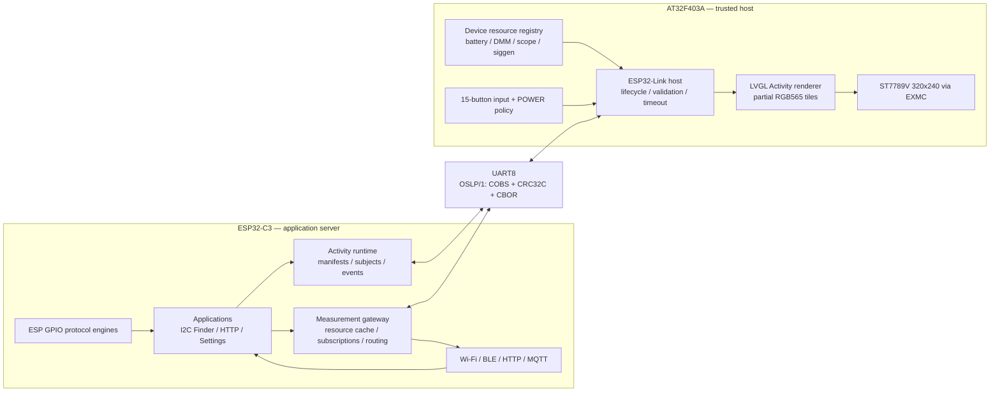
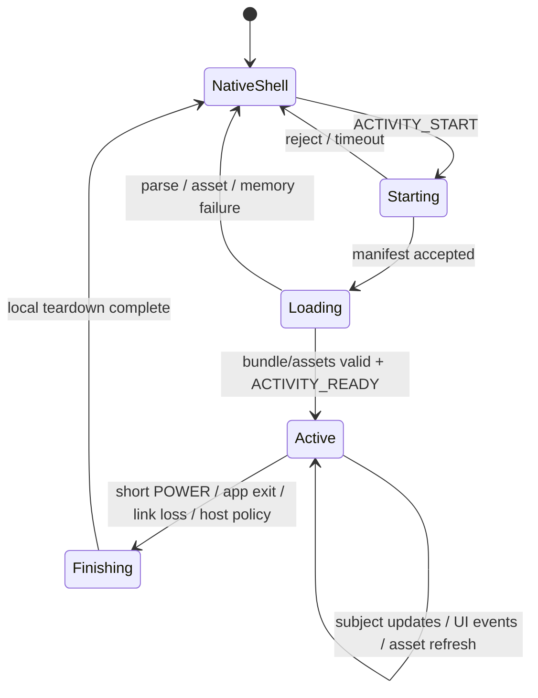

# ESP32-Link Activity Runtime

> **Status:** proposed architecture; no wire compatibility promise yet.  The
> current `firmware/src/drivers/esp_comm.*` implementation is an unwired
> prototype and is not this protocol.
>
> **Target hardware:** FNIRSI 2C53T-V1.4, AT32F403A host and ESP32-C3
> communication co-processor connected through PE0/PE1 (UART8).

## 1. Purpose

ESP32-Link turns the AT32 firmware into a safe, reusable display-and-input
host for applications whose logic and measurements run on an ESP32.  Adding
an ESP-side application should not require rebuilding the oscilloscope
firmware as long as the application can be expressed using the renderer,
assets, input events, and lifecycle operations already supported by the host.

Examples include:

- ESP32 and Wi-Fi settings;
- an I2C address finder using ESP32 GPIOs;
- UART, I2C, 1-Wire, pulse, or low-speed SPI tools implemented on the ESP32;
- an HTTP demonstration that downloads text and an image;
- MQTT clients, data loggers, BLE tools, and network diagnostics;
- future applications delivered with ESP32 firmware or, after a security
  model exists, as signed ESP32 application bundles.

The central invariant is:

> **ESP32 owns application behaviour and data.  AT32 owns the physical
> display, keyboard, system escape path, validation, and rendering.**

This is a thin-client architecture, not native-code module loading on AT32.
ESP32 never sends executable ARM code, raw function pointers, peripheral
register addresses, or arbitrary calls into the oscilloscope firmware.

## 2. Goals and non-goals

### 2.1 Goals

1. New ESP-side applications can provide menus and screens without an AT32
   firmware change.
2. An Activity can display positioned text, raster images, and vector/UI
   primitives using a retained object tree.
3. Static layout is sent once; changing values update bindings or individual
   objects rather than repainting the whole screen over UART.
4. All physical buttons can be reported to the active Activity with press,
   release, repeat, and long-press semantics.
5. A short POWER press always exits the active Activity.  A long POWER hold
   always remains a local power-off path.
6. Either endpoint may reboot independently and recover without a power cycle.
7. Corrupt, stale, oversized, or unsupported data fails closed and returns the
   user to a native screen.
8. The protocol advertises renderer and resource capabilities so newer ESP
   applications can adapt to older AT32 firmware.
9. Native AT32 measurements can be exported to ESP32 and routed to Wi-Fi,
   BLE, MQTT, HTTP, WebSocket, or logging independently of any Activity.

### 2.2 Non-goals

- General remote execution on AT32.
- Exposing arbitrary AT32 memory or peripheral registers.
- Replacing the native scope, meter, signal-generator, settings, or recovery
  UI in the first implementation.
- Streaming a full 320x240 framebuffer continuously as the normal UI model.
- Allowing ESP32 to suppress shutdown, bootloader entry, battery protection,
  watchdog recovery, or other host safety policy.
- Promising that a future application can use a widget or codec that was never
  compiled into the AT32 renderer.  Applications are portable across the
  declared capability set, not across imaginary future primitives.

## 3. System architecture



The native OpenScope renderer remains in place for native modes.  LVGL is
instantiated only for ESP32-Link Activities and uses a partial render buffer;
there is no permanent full-screen RGB565 framebuffer.

## 4. Existing project state

There is already a draft `esp_comm` source pair and a corresponding entry in
the Makefile.  It currently defines packets as:

```text
0xAA | command | big-endian length | payload | XOR checksum
```

It also serializes native C structures, assumes request/response half-duplex
operation, and assigns a new command number to every feature.  That prototype
is useful evidence of the intended physical link, but it must be replaced
before hardware compatibility is declared because:

- XOR misses many multi-bit errors;
- a damaged length delays resynchronization;
- native structures make padding, `enum` width, and byte order part of the
  accidental ABI;
- half-duplex command polling cannot represent unsolicited Activity events;
- a fixed switch over `ESP_CMD_*` is the opposite of a generic UI runtime;
- its module and firmware handlers are TODO scaffolding, not working storage
  or update paths.

A representative 2026-08-17 hardware build reports:

```text
text + rodata: 532,504 bytes
data:              436 bytes
bss:           213,252 bytes
firmware.bin:  532,952 bytes
```

The application linker region provides 932 KiB after reserved pages, so flash
has useful headroom.  Static RAM headroom is small, but the firmware already
owns a 118,784-byte lifecycle-managed shared pool.  ESP32-Link must use that
pool exclusively while active rather than adding another large `.bss` arena.

## 5. Hardware link

The intended wiring is:

```text
AT32 PE1 / UART8_TX  -- 470R..1k --  ESP32-C3 RX
AT32 PE0 / UART8_RX  -- 470R..1k --  ESP32-C3 TX
AT32 GND             ------------  ESP32-C3 GND
```

Both sides use 3.3 V logic.  UART is electrically full duplex even though
some higher-level transfers are request/response.  The ESP32 supply is a
separate hardware concern: initial tests should power it externally, and an
internal installation needs a regulator sized for Wi-Fi current peaks,
local bulk/ceramic decoupling, and an EMI check against the analog front end.

Bring-up starts at 115,200 baud.  The intended normal rate is 921,600 baud,
subject to a hardware soak test.  The negotiated protocol does not perform
automatic baud detection; both firmwares carry the same configured default.

## 6. Technology choice: LVGL runtime XML

The preferred renderer foundation is a pinned LVGL release with its runtime
XML subsystem.  LVGL can load declarative screens and components from data at
runtime and provides layout, clipping, focus, styles, widgets, input-device
handling, partial rendering, image/font registration, and subject-based data
binding.  This avoids growing a private drawing-command protocol into a second
GUI toolkit.

The version and exact enabled feature set are part of the AT32 renderer ABI.
The initial candidate is LVGL 9.5.x, but the pin is accepted only after a size
and lifecycle proof-of-concept.  The XML/runtime APIs and generated bundles
must be pinned to the same LVGL version; ESP applications cannot assume that
an arbitrary newer LVGL XML dialect will work.

Only a safe, precompiled widget set is registered.  Runtime XML may refer to
one generic event bridge callback, known fonts/images, declared subjects, and
known widgets.  It may not resolve arbitrary C callback names.

If the LVGL proof-of-concept cannot meet the RAM or teardown requirements, the
fallback is a compact retained scene graph using the same transport, lifecycle,
manifest, asset, and input services described below.  Full framebuffer/RFB
streaming is not the fallback because it moves every repaint onto the UART.

## 7. Protocol layering

```text
Layer 4  Activity manifests, lifecycle, subjects, events, assets
Layer 3  CBOR application messages or raw asset chunks
Layer 2  OSLP/1 envelope, transactions, sequence, flow control
Layer 1  COBS framing + trailing 0x00 + CRC32C
Layer 0  UART8, 8 data bits, no parity, 1 stop bit
```

OSLP means **OpenScope Link Protocol**.  The transport is asynchronous: both
endpoints may send events at any time once the session is established.

## 8. OSLP/1 frame format

Each decoded frame has a fixed 16-byte header, a bounded payload, and a
four-byte CRC32C.  Multibyte fields are little-endian.

| Offset | Size | Field | Meaning |
|---:|---:|---|---|
| 0 | 2 | `magic` | ASCII `OS` (`0x4F 0x53`) |
| 2 | 1 | `major` | incompatible protocol version; initially `1` |
| 3 | 1 | `minor` | backward-compatible revision |
| 4 | 1 | `kind` | request, response, event, stream, ack, error |
| 5 | 1 | `flags` | payload format and fragmentation flags |
| 6 | 1 | `service` | core, application, UI, asset, stream, device |
| 7 | 1 | `opcode` | operation inside the service |
| 8 | 2 | `session_id` | changes after either endpoint restarts |
| 10 | 2 | `transaction_id` | correlates request/response; zero for events |
| 12 | 2 | `sequence` | monotonically advances independently per direction |
| 14 | 2 | `payload_length` | decoded payload bytes |
| 16 | N | `payload` | CBOR item or raw chunk |
| 16+N | 4 | `crc32c` | header and payload, excluding the CRC field |

The complete decoded frame is COBS-encoded and terminated by `0x00`:

```text
COBS(header | payload | crc32c) | 0x00
```

COBS makes `0x00` an unambiguous boundary.  After noise, truncation, endpoint
reset, or a parser timeout, a receiver discards bytes through the next zero
and begins with a clean frame.  CRC32C validates the header as well as data.

Initial limits:

```text
maximum decoded frame:       1,024 bytes
maximum CBOR control payload: 768 bytes
asset/stream chunk data:      up to negotiated remainder
maximum outstanding request: 4 per endpoint
```

The limits are negotiated downward during `HELLO`; neither side allocates from
an untrusted length before checking it against its compile-time maximum.

### 8.1 Frame kinds

| Kind | Semantics |
|---|---|
| `REQUEST` | operation requiring one terminal response |
| `RESPONSE` | successful response with matching transaction ID |
| `EVENT` | unsolicited best-effort state or input notification |
| `STREAM` | credit-controlled bulk data |
| `ACK` | accepted fragment/chunk/window |
| `ERROR` | terminal failure with structured error payload |

### 8.2 Flags

| Bit | Name | Meaning |
|---:|---|---|
| 0 | `PAYLOAD_CBOR` | payload is one complete definite-length CBOR item |
| 1 | `PAYLOAD_RAW` | payload follows an opcode-specific binary format |
| 2 | `MORE` | more fragments belong to this transaction/object |
| 3 | `REPLAY` | retransmission of an earlier idempotent request/chunk |
| 4 | `URGENT` | reserved for host-safe lifecycle/control traffic |
| 5..7 | — | reserved; transmit zero, ignore when optional |

`PAYLOAD_CBOR` and `PAYLOAD_RAW` are mutually exclusive.  Unknown mandatory
flags cause `UNSUPPORTED`; unknown reserved zero-compatible flags are ignored
only when a future minor-version rule explicitly permits it.

## 9. Session establishment and recovery

Either endpoint may boot first.  Until a session exists, ESP sends `HELLO`
approximately every 500 ms with a random boot nonce.  AT32 replies with its
own nonce and capabilities.  Both derive a non-zero `session_id` from the two
nonces or explicitly carry a random negotiated ID.

`HELLO` includes:

```text
protocol major/minor range
firmware name and semantic version
build identifier
maximum decoded frame
maximum outstanding requests
supported services
renderer capability hash
asset formats
heartbeat interval
```

A new `HELLO` nonce invalidates the old session immediately.  Frames carrying
an old session ID are ignored; an error response is not required because the
old peer may no longer exist.

After negotiation:

- each side sends a heartbeat when otherwise idle;
- three missed heartbeat intervals mark the link unavailable;
- an active Activity is terminated locally with reason `LINK_LOST`;
- transient parser failure never forces a device reset;
- reconnect returns to the native ESP32-Link shell, not blindly to the old
  Activity, unless a future resumable-state capability is negotiated.

## 10. Services

Stable service IDs keep transport routing independent of application names.

| ID | Service | Responsibilities |
|---:|---|---|
| `0x00` | Core | HELLO, capabilities, heartbeat, error, credit |
| `0x01` | Application | enumerate, start, finish, lifecycle |
| `0x02` | UI | Activity bundle, subjects, patches, UI events |
| `0x03` | Asset | metadata, transfer, cache, request, release |
| `0x04` | Stream | credit-controlled waveform and other bulk streams |
| `0x05` | Device | catalog, read, subscribe, telemetry, whitelisted control |
| `0x80..0xFF` | Experimental | no compatibility promise before assignment |

New ESP applications normally require no new service or opcode.  They differ
through manifests, Activity bundles, subjects, event IDs, and assets.

## 11. Application manifests and enumeration

Opening the native `ESP32 Link` item sends `APP_LIST_REQUEST`.  ESP responds
with an array of manifests.  A manifest contains:

| Field | Required | Meaning |
|---|---|---|
| `app_id` | yes | stable ESP-local unsigned ID |
| `name` | yes | UTF-8 display name |
| `version` | yes | application semantic version |
| `description` | no | one short UTF-8 summary |
| `icon_asset_id` | no | icon in a supported asset format |
| `bundle_hash` | yes | identifies layout/assets for cache validation |
| `required_caps` | yes | capabilities that must all be present |
| `optional_caps` | no | features the app can adapt around |
| `permissions` | yes | network/GPIO/device features disclosed by ESP |
| `preferred_viewport` | no | content/full-screen preference |

`app_id = 0` is reserved for an ESP-provided shell Activity.  AT32 may launch
it to render the main remote application menu, but it always retains a native
fallback list and connection/error screen.  A malformed shell can therefore
be exited or bypassed exactly like any other Activity.

An app whose required capabilities are unavailable is shown as incompatible
with a reason; it is not partially launched and allowed to fail later.

## 12. Activity lifecycle



Every start receives a fresh 32-bit `activity_token` carried inside all
Application, UI, Asset, and input payloads.  The 16-bit transport session ID
protects against endpoint restarts; the Activity token protects against late
packets from a previous screen in the same session.

Lifecycle operations:

```text
APP_LIST_REQUEST / APP_LIST
ACTIVITY_START
ACTIVITY_ACCEPTED or ACTIVITY_REJECTED
ACTIVITY_BUNDLE_BEGIN / CHUNK / END
ACTIVITY_READY
ACTIVITY_SUSPEND / RESUME          optional future capability
ACTIVITY_FINISH
ACTIVITY_FINISHED
```

The host owns final teardown.  `ACTIVITY_FINISH` is a notification/request for
ESP cleanup, not permission for AT32 to leave the screen.

## 13. Activity bundle

An Activity bundle consists of:

1. a CBOR bundle manifest;
2. UTF-8 LVGL XML or a version-pinned compiled XML bundle;
3. an asset directory;
4. initial subject definitions and values;
5. capability requirements and resource limits.

The initial development format should remain inspectable: UTF-8 XML plus CBOR
metadata.  A compiled bundle can be added after the runtime loader is stable,
but it must identify the exact LVGL XML ABI/tool version that produced it.

The bundle is transferred into a staging arena.  AT32 verifies:

- complete byte count;
- bundle hash;
- transport CRC on every frame;
- XML/bundle version;
- maximum nesting, objects, strings, subjects, and assets;
- every widget, property, font, image format, and callback name;
- coordinates and allocations before replacing the visible Activity.

Only after validation succeeds does the host create the live LVGL object tree.
An incomplete bundle is never rendered as a partially trusted screen.

## 14. Viewport and host overlays

Coordinates are integer pixels relative to a host-provided viewport.  AT32
reports the actual viewport in `ACTIVITY_START`; an Activity must not assume
that all 320x240 pixels are available.

Suggested modes:

```text
CONTENT: x=0, y=18, width=320, height=206
FULL:    x=0, y=0,  width=320, height=240
```

`CONTENT` preserves a native status strip and optional key/help strip.  `FULL`
is a negotiated capability for applications such as image viewing, but host
shutdown, low-battery, crash, and disconnect overlays always remain above the
Activity.  Activity coordinates are clipped to the viewport even if malicious
or corrupt XML specifies negative or oversized bounds.

Color inputs may be RGB888 in authoring XML; the renderer converts them to the
native RGB565 LCD format.  Theme names are optional capabilities, not semantic
requirements: an application must remain usable with its explicit fallback
colors.

## 15. Text and fonts

All protocol strings are UTF-8.  Initial host fonts should cover at least:

- printable ASCII;
- Latin-1 characters needed for units and names;
- Greek symbols commonly used by instruments (`µ`, `Ω`, `Δ`);
- Cyrillic if Russian localization is shipped.

Stable font roles are preferable to raw filenames:

```text
small     approximately 12 px
medium    approximately 16 px
large     approximately 24 px
xlarge    approximately 48 px
mono      diagnostic/code text
```

Activity text properties include foreground/background color, font role,
alignment, wrapping, clipping, and ellipsis.  Unknown glyphs render a visible
replacement character; they must never disappear silently or corrupt layout.

Runtime font assets are a later optional capability.  If supported, they are
bounded bitmap fonts registered through the Asset service, not arbitrary font
parser inputs.  The first version should generate LVGL-compatible built-in
fonts from the project's existing SF Pro/Menlo sources.

## 16. Graphics and widget capability set

The first renderer should compile a deliberately broad but bounded set:

### 16.1 Primitives

- solid and outlined rectangle;
- line and polyline;
- circle and arc;
- text label;
- raster image;
- clipping container;
- focus/highlight border.

### 16.2 Widgets

- container and flex/grid layout;
- list;
- button;
- checkbox;
- slider;
- progress bar;
- table;
- chart;
- spinner/loading indicator;
- image and label.

New applications compose these widgets.  Custom application logic remains on
ESP.  A future widget is introduced through a new renderer capability, never
by treating an unknown XML element as a known one.

Alpha blending, arbitrary transforms, vector paths, gradients, animation, and
anti-aliased large canvases are optional capabilities because they can require
substantial RAM or pixel reads.  The baseline must render correctly without a
full framebuffer.

## 17. Subjects and live updates

Static XML defines named subjects and binds widget properties to them.  ESP
updates values with `SUBJECT_SET` rather than retransmitting markup.

Supported baseline subject types:

```text
int32
uint32
float32
bool
UTF-8 string with negotiated maximum length
RGB565/RGB888 color
enum/integer selection
asset reference
bounded numeric array for a chart
```

Example update:

```cbor-diag
{
  0: 0x9A31F2C4,             / activity_token /
  1: "http_status",         / subject /
  2: 184,                   / revision /
  3: "HTTP 200, 1842 B"     / value /
}
```

Subject revisions are monotonic per Activity.  A delayed update with a lower
revision is ignored.  Multiple updates that must appear together use
`UI_BATCH_BEGIN`, `SUBJECT_SET...`, `UI_BATCH_COMMIT`; the renderer invalidates
and paints only after commit.  A timed-out or invalid batch is discarded.

The host coalesces repeated updates to the same subject before rendering.  ESP
must not use UART update rate as an animation clock; renderer-advertised frame
and update limits are authoritative.

## 18. Raster assets

ESP performs network fetch, PNG/JPEG parsing, resizing, orientation, and color
conversion.  AT32 receives only simple bounded display formats:

| Format | Baseline | Use |
|---|---|---|
| `MONO1` | yes | glyphs, masks, small icons |
| `RGB565_RAW` | yes | photos and already packed tiles |
| `RGB565_RLE` | yes | flat UI artwork and large solid regions |
| `INDEX8_RGB565_PALETTE` | optional | diagrams with limited colors |
| PNG/JPEG | no | decoded and resized by ESP before transfer |

An asset descriptor contains:

```text
activity_token
asset_id
format
width, height
decoded byte count
encoded byte count
content hash
storage hint: transient / activity-cache / persistent-cache
```

Transfers use `ASSET_BEGIN`, credit-controlled `ASSET_CHUNK`, and `ASSET_END`.
The host verifies dimensions and decoded-size arithmetic before allocating or
drawing.  A full 320x240 RGB565 image is 153,600 bytes and does not fit beside
the Activity runtime in the current shared pool; it must be tiled, streamed,
or cached in an explicitly assigned W25Q scratch region.

The baseline caching policy is:

- small assets live in the Activity arena;
- large images arrive as bounded horizontal tiles;
- the LCD retains pixels after drawing;
- if an invalidation needs a tile no longer cached, AT32 sends
  `ASSET_TILE_REQUEST` and displays a placeholder until it arrives;
- persistent W25Q caching is opt-in and wear-managed, never an implicit write
  on every HTTP refresh.

## 19. Input model

The host reports physical and semantic input.  Physical key events contain:

```text
activity_token
key_code
action: DOWN / UP / REPEAT / LONG
held_ms
event_sequence
```

Stable physical key codes match the 15 confirmed buttons:

```text
CH1 CH2 MOVE SELECT TRIGGER PRM AUTO SAVE MENU
UP DOWN LEFT RIGHT OK POWER
```

An Activity selects one input policy:

| Policy | Behaviour |
|---|---|
| `RAW` | all non-reserved keys are forwarded; ESP owns navigation |
| `LOCAL_FOCUS` | arrows/OK drive an LVGL keypad group; semantic UI events go to ESP |
| `BOTH` | local focus plus raw events, with explicit event sequence IDs |

The preferred policy is `LOCAL_FOCUS`: focus motion and visual response do not
wait for UART, while application actions and value changes still reach ESP.

LVGL runtime XML may register only a generic callback such as
`os_remote_event`.  The callback converts a validated widget/event identifier
into `UI_EVENT`:

```text
activity_token
widget_id
event: CLICKED / VALUE_CHANGED / FOCUSED / DEFOCUSED
typed value, if any
event_sequence
```

ESP-provided callback names are data labels.  They are never resolved to
arbitrary AT32 symbols.

## 20. POWER and system key policy

POWER is host-reserved and cannot be captured or cancelled by an Activity.

### 20.1 Short POWER press while an Activity is active

1. AT32 observes press and release before the shutdown threshold.
2. AT32 sends `ACTIVITY_FINISH` with reason `POWER_SHORT`.
3. AT32 tears down the Activity and returns to the native ESP32-Link shell.
4. ESP may acknowledge cleanup, but AT32 does not wait indefinitely and does
   not allow ESP to veto the transition.

This finish notification is the Activity's equivalent of an Android-style
back/close lifecycle event.  The application can close sockets or scans after
receiving it, but the screen has already become host-owned.

### 20.2 Long POWER hold

The existing three-second local countdown and power-off remain authoritative.
The Activity may be notified with reason `SYSTEM_SHUTDOWN`, but notification
failure cannot delay shutdown.

### 20.3 MENU+POWER

The existing bootloader handoff remains higher priority than Activity input.
ESP never receives a combination it could use to prevent recovery.

The current input handler blocks inside the POWER countdown.  ESP32-Link
requires refactoring it into a non-blocking host power state machine so a short
release can be distinguished cleanly and the display task remains responsive.

## 21. Flow control and scheduling

There are no RTS/CTS pins, so flow control is explicit.

- Control frames are small and processed from bounded high-priority queues.
- Asset and stream data require receiver credit measured in bytes.
- A sender never has more asset bytes in flight than the last granted credit.
- At least one control-frame slot is reserved so `FINISH`, `ERROR`, heartbeat,
  and credit updates cannot deadlock behind image data.
- UART ISR code moves bytes only between the peripheral and ring buffers.
- COBS, CRC, CBOR, XML, asset decoding, LVGL, and application dispatch never
  run in an interrupt.
- TX uses an interrupt- or DMA-driven ring where UART8 support permits it;
  RX uses a bounded ring and parser task.

Suggested AT32 tasks/components:

```text
esp_uart_rx_isr       bytes -> RX ring
esp_uart_tx_isr/DMA   TX ring -> UART
esp_link_task         framing, CRC, sessions, transactions
esp_activity_task     manifests, bundles, subjects, lifecycle
esp_device_task       catalog, subscriptions, telemetry snapshots
display_task          remains sole normal LCD renderer
```

The Activity runtime submits display work to the display task rather than
writing the LCD concurrently.  Entering Activity mode activates the same modal
ownership principle already used to stop native periodic redraws from painting
over a host-owned screen.

## 22. Memory lifecycle

Add a dedicated `SHMEM_OWNER_ESP_LINK`; do not alias it permanently to the
generic module owner.  A provisional 118,784-byte partition is:

| Region | Budget | Purpose |
|---|---:|---|
| LVGL heap/object arena | 48 KiB | objects, styles, bindings |
| one RGB565 tile | 12.5 KiB | 320x20 partial render buffer |
| Activity staging/XML | 16 KiB | initial bundle and validation |
| asset/tile cache | 32 KiB | icons or partial large image |
| protocol/scratch reserve | about 8 KiB | decode, alignment, metadata |

These are PoC budgets, not promises.  The implementation must measure high
water marks and either reject an Activity before destroying the current screen
or render a native `Activity too large` error.

Lifecycle order is strict:

```text
enter ESP32-Link mode
acquire shared pool
partition/init Activity allocator
initialize LVGL remote runtime
load and run Activity
destroy all Activity objects
deinitialize remote LVGL state
invalidate every pool pointer
release shared pool
redraw native screen
```

FFT, persistence, screenshot, decode, and ESP Activity ownership cannot overlap
unless a future measured memory layout explicitly proves coexistence.

## 23. Security and robustness boundary

Even when ESP firmware is trusted, HTTP text/images and future downloaded
bundles are untrusted parser inputs.  AT32 enforces compile-time and negotiated
limits before calling LVGL or touching the LCD.

Baseline limits should cover:

- maximum XML/bundle bytes;
- maximum nesting depth;
- maximum object, subject, style, and asset counts;
- maximum string and property lengths;
- maximum image dimensions and decoded bytes;
- checked multiplication for `width * height * bytes_per_pixel`;
- viewport clipping and signed-coordinate handling;
- maximum vector points and chart samples;
- maximum updates and painted pixels per scheduling interval;
- parser and Activity watchdog time budgets.

Required safety rules:

1. No raw memory, GPIO, LCD register, flash address, or function-call opcode.
2. Unknown required capability rejects launch; unknown optional metadata is
   ignored according to its versioning rule.
3. Only registered widgets, properties, fonts, codecs, subjects, and the
   generic event bridge are accepted.
4. Firmware update, calibration write, shutdown, and bootloader operations are
   outside the Activity UI service and require separate trusted policy.
5. Invalid input produces a structured error and a native fallback screen,
   not a hard fault or an endless retry loop.
6. A remote Activity cannot draw over a host fatal-error or power overlay.
7. Downloadable third-party ESP applications require signed bundles and a
   permission model before that distribution path is enabled.

## 24. Compatibility rules

- Protocol major changes only for incompatible envelope or semantic changes.
- Minor revisions may add optional fields, opcodes, widgets, or capabilities.
- CBOR maps use integer keys on the wire; unknown optional keys are ignored.
- Every field has a specified integer width and byte order; C structures are
  never serialized directly.
- Stable IDs are never reused for different meanings.
- Activity bundles declare required and optional capability sets.
- Renderer capabilities include a hash so ESP can cache compatibility results.
- Subject updates carry revisions; old revisions are ignored.
- Requests that may be retransmitted are idempotent by transaction ID, or the
  response is cached long enough to prevent duplicate side effects.
- Experimental service IDs do not become stable merely because a prototype
  used them.

## 25. Example: I2C Finder

1. ESP advertises `I2C Finder` with requirements `label`, `list`, `button`, and
   `progress`.
2. User launches it from the ESP shell.
3. Activity XML shows selected ESP SDA/SCL pins, scan speed, a `Scan` action,
   progress, and an initially empty result list.
4. AT32 handles focus locally.  Pressing OK on `Scan` generates
   `UI_EVENT(widget_id="scan", CLICKED)`.
5. ESP scans its own I2C bus.  It updates `scan_progress` and `status_text`.
6. ESP publishes the discovered address array; the list binding redraws.
7. Short POWER sends `ACTIVITY_FINISH(POWER_SHORT)` and immediately returns to
   the ESP app menu.  ESP releases its I2C driver in response.

No I2C-specific AT32 command, widget, or firmware branch is required.

## 26. Example: HTTP text and image

1. Activity shows URL/status labels, an image placeholder, and `Fetch`.
2. `Fetch` generates a generic UI event.
3. ESP performs DNS/TLS/HTTP and reports progress through string/integer
   subjects.
4. ESP sanitizes the returned text for the Activity's length limit.
5. ESP decodes the downloaded PNG/JPEG, scales it to the declared rectangle,
   converts it to RGB565, and chooses RAW or RLE transfer.
6. AT32 validates and draws image tiles, then binds the completed asset ID to
   the image widget.
7. Network errors are ordinary subject values, not renderer errors.

AT32 contains no HTTP, TLS, PNG, or JPEG dependency for this application.

## 27. Device Resource and Telemetry Service

Activity rendering and measurement export are separate peer subsystems.  The
Activity Runtime lets ESP supply an interface for the AT32 LCD.  The Device
Resource and Telemetry Service lets AT32 publish native instrument state and
measurements to ESP for Wi-Fi, BLE, logging, or ESP-side applications:

```text
AT32 meter/scope/system producers
            |
            v
Device Resource Registry -- OSLP/1 --> ESP Measurement Gateway
                                             |
                          +------------------+------------------+
                          |                  |                  |
                      WebSocket            MQTT              HTTP/BLE/CSV
```

The telemetry service remains available while the LCD shows a native scope,
meter, signal-generator, or settings screen.  It does not require an Activity
to be loaded and must not allocate from the Activity/LVGL shared-memory arena
for ordinary scalar telemetry.

### 27.1 ESP-side Measurement Gateway

ESP firmware contains a distinct `Measurement Gateway` component rather than
embedding AT32 parsing separately in every network feature.  It owns:

```text
device catalog cache       resource descriptors keyed by catalog hash
subscription manager       desired rates, on-change/latest-only policy
telemetry cache            latest atomic value and quality per resource
stream receiver            credit window and current waveform assembly
format adapters            CBOR <-> JSON/MQTT/BLE/CSV representations
client arbitration         combines several Wi-Fi client subscriptions
```

HTTP, MQTT, WebSocket, BLE, and an ESP Activity all consume the same cached
resource state.  They do not send independent high-rate subscriptions to AT32.
If three browser clients request the same 10 Hz waveform, ESP maintains one
AT32 subscription and fans out the latest frame locally.

Network disconnection does not alter the AT32 measurement mode by default.
ESP simply releases subscriptions no longer needed after a bounded grace
period.  Conversely, an AT32 link reset invalidates the ESP catalog and all
cached telemetry until a new session and catalog are established.

### 27.2 Resource catalog

AT32 exposes a self-describing catalog after `HELLO`.  Each resource has a
stable numeric ID for efficient telemetry and a UTF-8 path for discovery and
debugging.

| Descriptor field | Meaning |
|---|---|
| `resource_id` | stable non-zero ID within the Device service ABI |
| `path` | human-readable hierarchical name |
| `schema_id` / `schema_hash` | exact value payload definition |
| `access` | read, subscribe, and optionally whitelisted write/call |
| `unit` | SI/unit identifier when applicable |
| `min_period_us` | fastest honest producer/update interval |
| `delivery_modes` | snapshot, on-change, periodic, latest-only |
| `required_mode` | native device mode or state, if restricted |
| `quality_model` | validity/refusal states used by the producer |
| `capabilities` | optional fields or stream formats |

Initial resource paths should include:

```text
system/uptime
system/battery/percent
system/battery/voltage
system/usb/present
device/mode

meter/reading
meter/statistics
meter/hold

scope/frame
scope/measurements
scope/config

siggen/state
```

Paths are not transmitted with every sample.  ESP downloads descriptors only
when the catalog hash changes, then telemetry refers to compact resource and
schema IDs.

### 27.3 Device service operations

Baseline operations are:

| Operation | Direction | Meaning |
|---|---|---|
| `CATALOG_HASH` | AT32 -> ESP | identify the current descriptor catalog |
| `DESCRIBE` | ESP -> AT32 | request all or selected descriptors |
| `READ` | ESP -> AT32 | request one current atomic snapshot |
| `SUBSCRIBE` | ESP -> AT32 | request ongoing delivery policy/rate |
| `SUBSCRIBE_RESULT` | AT32 -> ESP | return accepted rate and policy |
| `UNSUBSCRIBE` | ESP -> AT32 | release subscription |
| `TELEMETRY` | AT32 -> ESP | scalar or bounded structured snapshot |
| `RESOURCE_ERROR` | AT32 -> ESP | unsupported, unavailable, wrong mode, etc. |

Bulk waveform bytes use the Stream service after `SUBSCRIBE` accepts the
`scope/frame` resource.  Device messages carry frame metadata and Stream
messages carry raw chunks associated by frame number and stream ID.

Whitelisted `WRITE` or `CALL` operations are optional and separate from
telemetry.  A read-only catalog is valid.  Generic memory/register writes are
never exposed as resources.

### 27.4 Subscription semantics

An ESP subscription states intent rather than commanding an impossible rate:

```cbor-diag
{
  0: 0x1001,        / resource_id /
  1: 250000,        / requested minimum period in microseconds /
  2: "on_change",  / delivery policy /
  3: "latest_only" / queue policy /
}
```

AT32 responds with the actual accepted period and policy.  It may reduce rate,
refuse because the required native mode is inactive, or provide stale/last
known data only when the descriptor explicitly permits it.

Supported delivery policies:

- `snapshot`: one response to `READ`;
- `on_change`: send when producer revision changes, optionally with a maximum
  silence interval;
- `periodic`: send the latest committed value at the accepted period;
- `latest_only`: for live streams, discard superseded unsent frames instead of
  accumulating latency.

Subscriptions are scoped to the OSLP session and disappear on reconnect.
They have no hidden persistence across ESP or AT32 reboot.

### 27.5 Multimeter snapshot

Multimeter data is low bandwidth and should normally publish on producer
revision changes (currently about four updates per second).  The payload is an
atomic structured measurement, not only the LCD's formatted string:

```text
resource_id
revision
timestamp_us
mode                    DCV / ACV / DCA / resistance / ...
numeric_value           float32 when valid
unit_id                 volt / ampere / ohm / farad / hertz / ...
range_id
sign and overload flags
quality
raw/display metadata    optional capability
display_text            optional, never the only numeric representation
```

Quality is mandatory.  At minimum it distinguishes:

```text
VALID
STALE
OVERLOAD
UNSTABLE
WRONG_FRAME_FAMILY
REFUSED_UNRESOLVED_CALIBRATION
UNAVAILABLE_IN_CURRENT_MODE
```

The Wi-Fi UI must preserve AT32's measured-or-refuse policy.  It may not turn
an invalid/refused reading into `0`, reuse a stale number without marking it,
or apply an ESP-side coefficient that the native firmware does not claim.

The optional `display_text` allows a remote UI to reproduce the LCD exactly,
while `numeric_value` and `unit_id` remain authoritative for charts, MQTT,
statistics, and CSV.

### 27.6 Oscilloscope frame metadata

Each committed acquisition publishes metadata before or with its raw stream:

```text
frame_number
producer_generation
capture_timestamp_us
channel mask
sample format
sample count / byte count
sample_rate_hz when measured/known
timebase_id
trigger index and state
trigger level metadata
per-channel range/coupling metadata
running/stopped state
quality
```

Raw samples remain byte strings.  They are not expanded into CBOR integer
arrays.  Baseline formats align with the existing FPGA acquisition buffers:

```text
U8_CH1
U8_CH2
U8_INTERLEAVED_CH1_CH2
```

The current acquisition sizes are 1,024 bytes for a normal transfer and up to
2,048 bytes for the dual-channel path.  At 921,600 baud, 8N1 provides about
92,160 wire bytes/s before protocol overhead.  Representative payload loads
are therefore:

```text
1,024 bytes * 20 frames/s = 20 KiB/s
2,048 bytes * 20 frames/s = 40 KiB/s
```

Those rates are plausible but not guaranteed until UART and concurrent-load
bench tests.  ESP requests a maximum rate; AT32 publishes only complete frames
at an accepted rate and prioritizes freshness over delivery of every frame.

### 27.7 Atomic publication and torn-frame prevention

Telemetry reads producer snapshots; it does not read mutable UI globals or an
acquisition buffer while another task is replacing it.

Scalar producers publish a structure followed by a monotonic revision using a
defined critical section or generation protocol.  Scope export uses one of:

1. retain a committed acquisition buffer until the exporter finishes;
2. copy it into a dedicated bounded TX snapshot before reuse; or
3. read generation before and after copying, publish only if both match, and
   discard/retry otherwise.

A mismatched generation is never transmitted as a low-quality waveform.  It
is not a measurement at all and is dropped.  Stream metadata and all chunks
carry the same frame number; ESP commits the frame to clients only after all
chunks, lengths, and hashes/CRCs agree.  A newer `latest_only` frame may cancel
an incomplete older frame explicitly.

### 27.8 UART arbitration and backpressure

The UART scheduler uses separate bounded queues and this priority order:

1. POWER, Activity finish, fatal/error, heartbeat, and flow-control frames;
2. keyboard/UI events and state-changing responses;
3. DMM, battery, and other low-rate scalar telemetry;
4. Activity subject updates;
5. live waveform streams;
6. Activity images, cached assets, and file/update transfers.

An HTTP image or waveform cannot delay short-POWER exit.  Bulk queues consume
credit; control traffic always retains at least one frame slot.  If Wi-Fi or
ESP processing falls behind:

- scalar `on_change` resources coalesce to the newest revision;
- live scope `latest_only` drops old unsent frames;
- reliable assets/files pause and resume from acknowledged chunks;
- no producer blocks the acquisition or meter processing task waiting for
  UART bandwidth.

### 27.9 Network mappings

The ESP Measurement Gateway may expose the same resource through several
adapters without changing AT32:

```text
WebSocket  binary/JSON telemetry and waveform frames for the browser
HTTP       GET /api/resources and GET /api/resource/<path>
MQTT       openscope/<device-id>/<resource-path>
BLE GATT   selected low-rate scalar resources only
CSV        timestamp, path, value, unit, quality
```

JSON is generated on ESP, not transported over UART.  MQTT topic names derive
from catalog paths, while payloads retain revision, timestamp, unit, and
quality.  Waveforms use binary WebSocket frames or files rather than thousands
of JSON numbers.

### 27.10 Compatibility boundary

New ESP networking, presentation, logging, and automation features can consume
existing catalog resources without rebuilding AT32.  A newly added AT32
measurement requires one AT32 update to implement and publish its producer and
descriptor; generic ESP catalog consumers can then discover it without a new
UART opcode.

A genuinely new AT32/FPGA hardware behaviour still requires an AT32
implementation and a newly advertised capability.  Neither Activity markup nor
the Device service pretends to execute unknown hardware behaviour.

## 28. Implementation plan and acceptance gates

### Phase 0 — Freeze the design and retire the prototype ABI

- assign protocol constants and CBOR keys in one normative header/spec table;
- mark `0xAA/XOR` `esp_comm` as legacy/unshipped;
- implement host-side COBS and CRC32C unit tests;
- add parser fuzz tests for truncation, corrupt lengths, random bytes, and
  repeated delimiters.

**Gate:** one million randomized parser inputs under host tests produce no
out-of-bounds access and always recover at the next valid frame.

### Phase 1 — Physical UART and session

- configure PE0/PE1 as UART8 RX/TX;
- ISR/ring-buffer transport;
- HELLO, heartbeat, sequence, request/response, reconnect;
- simple ESP test firmware and USB diagnostics.

**Gate:** bidirectional 921,600-baud soak for at least one hour with randomized
valid frames, injected corrupt frames, independent endpoint resets, zero
accepted bad CRCs, and successful automatic session recovery.

### Phase 2 — Device Resource and Telemetry service

- implement the catalog, descriptor hash, READ, SUBSCRIBE, and UNSUBSCRIBE;
- publish battery, device mode, and atomic DMM snapshots;
- implement the ESP Measurement Gateway catalog/subscription cache;
- route the same DMM value to WebSocket JSON, MQTT, and CSV test adapters;
- add latest-only scope metadata and raw stream after scalar telemetry passes;
- prove generation-safe acquisition copying or retention before enabling
  waveform export.

**Gate:** one frozen AT32 build exports native battery and DMM state through
all three ESP adapters with identical revision/value/unit/quality; a scope soak
exports only complete generation-consistent frames, coalesces backlog to the
latest frame, and never stalls acquisition when the receiver withholds credit.

### Phase 3 — Static Activity proof-of-concept

- pin and configure LVGL;
- partial RGB565 flush into the existing LCD driver;
- shared-pool allocator and clean teardown;
- one static XML screen with labels, shapes, list, and focus navigation.

**Gate:** enter/exit the Activity 1,000 times in emulator/host stress tests and
repeatedly on hardware without pool leakage, stale pointers, native redraw
corruption, watchdog reset, or stack-growth regression.

### Phase 4 — Remote bundles, subjects, and input

- manifest list and Activity lifecycle;
- validated XML/bundle staging;
- generic event callback;
- subject updates and atomic batches;
- short/long POWER state machine and link-loss fallback.

**Gate:** an ESP-only `Counter` app changes layout/data and handles all keys;
short POWER always exits, long POWER always shuts down, and unplugging/resetting
ESP at every lifecycle phase always returns AT32 to a usable native screen.

### Phase 5 — Assets

- MONO1, RGB565 RAW, RGB565 RLE;
- tile transfer, credit flow control, placeholders, cache invalidation;
- W25Q scratch use only after region-layer review.

**Gate:** HTTP demo displays known text and reference images with golden-image
comparison in the emulator and no buffer overrun for malformed dimensions,
truncated RLE, duplicate chunks, or cache eviction.

### Phase 6 — Real applications and hardening

- ESP settings shell;
- I2C Finder;
- HTTP demo;
- capability downgrade tests;
- EMI and battery-current characterization with Wi-Fi active/idle/off;
- documentation for application authors.

**Gate:** all three apps are delivered by changing ESP firmware only, run on
the same frozen AT32 build, and pass disconnect, malformed-input, memory
high-water, keyboard, POWER, and analog-noise acceptance tests.

## 29. Open decisions

1. Confirm LVGL 9.5.x runtime XML footprint and teardown behaviour, or pin a
   later known-good commit after the PoC.
2. Decide whether the default viewport preserves both status and bottom help
   bars or only the status bar.
3. Choose final control-frame and asset-chunk maxima after UART and stack tests.
4. Decide whether Activity XML is stored only in RAM or may be cached in W25Q.
5. Define the exact built-in Unicode ranges and generated LVGL fonts.
6. Decide whether large photo tiles are resent on demand or retained in a
   wear-managed W25Q cache.
7. Specify renderer capability IDs and the normative CBOR integer-key tables.
8. Determine whether UART8 can use DMA on this AT32 mapping; the protocol must
   work with interrupt-driven rings regardless.
9. Characterize ESP32-C3 power and RF noise before an internal power design is
   accepted.
10. Assign the first stable Device resource IDs and schema IDs without tying
    them to current C structure layouts.
11. Choose the scope snapshot ownership strategy after measuring copy time,
    acquisition cadence, and available non-Activity memory.
12. Define maximum concurrent client/subscription policy in the ESP gateway and
    the grace period before unused AT32 subscriptions are released.

## 30. References

- [LVGL runtime XML loading](https://docs.lvgl.io/master/xml/integration/xml.html)
- [LVGL declarative XML overview](https://docs.lvgl.io/master/xml/xml/overview.html)
- [LVGL XML events and runtime callback registration](https://docs.lvgl.io/master/xml/ui_elements/events.html)
- [LVGL partial display rendering](https://docs.lvgl.io/9.1/porting/display.html)
- [RFC 8949 — CBOR](https://www.rfc-editor.org/rfc/rfc8949.html)
- [Consistent Overhead Byte Stuffing, Cheshire and Baker](https://stuartcheshire.org/papers/COBSforToN.pdf)
- [RFC 6143 — Remote Framebuffer Protocol](https://www.rfc-editor.org/rfc/rfc6143.html)
- [`firmware/src/drivers/esp_comm.h`](../../firmware/src/drivers/esp_comm.h)
- [`firmware/src/drivers/esp_comm.c`](../../firmware/src/drivers/esp_comm.c)
- [`firmware/src/dsp/shared_mem.h`](../../firmware/src/dsp/shared_mem.h)
- [`firmware/src/drivers/lcd.h`](../../firmware/src/drivers/lcd.h)
- [`firmware/src/tasks/input_handler.c`](../../firmware/src/tasks/input_handler.c)
